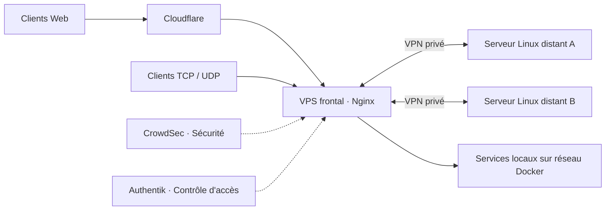

# DevSecOps — Linux, Infrastructure & Sécurité

**Portfolio technique · Administration Linux · Réseau · Docker · Sécurité · DevOps**

J'utilise ce dépôt pour documenter les **systèmes que j'administre**, les choix techniques que j'ai faits et ce que j'apprends au fil des projets. Malgré son nom, il ne se limite pas au DevSecOps : il couvre aussi l'exploitation Linux, les réseaux, la conteneurisation, le stockage et l'automatisation.

Je privilégie les **retours d'expérience concrets**, les exemples compréhensibles et les limites clairement expliquées. Ce dépôt ne contient **ni mes fichiers de production ni la topologie exacte de mon infrastructure**. Les configurations proposées sont des **reconstructions détaillées et anonymisées**, fondées sur mes choix de déploiement réels (Nginx, WireGuard, CrowdSec, Guacamole, Arcane). Elles ne remplacent ni les fichiers de production ni les tests.

## Projets et retours d'expérience

| Sujet | Ce que j'ai mis en place / étudié |
| --- | --- |
| [Réseau multi-sites](projects/network-edge/README.md) | VPS frontal, WireGuard, Nginx HTTP(S) et Stream TCP/UDP |
| [Plateforme Docker](projects/docker-platform/README.md) | Passage de Proxmox à Docker Compose, réseaux et persistance |
| [CrowdSec](projects/crowdsec/README.md) | Collecte centralisée d'événements et remédiation Web/réseau |
| [Authentik et IAM](projects/identity-access/README.md) | OIDC et Forward Auth pour des accès d'administration |
| [Arcane](projects/docker-management/README.md) | Administration de plusieurs environnements Docker depuis un seul outil |
| [Stockage et résilience](projects/storage-reliability/README.md) | ZFS, redondance, arrêt propre, retour sur une alerte |

Les projets décrivent des solutions effectivement utilisées dans mon environnement, **sans revendiquer de tests ou de garanties que je n'ai pas mesurés**.

Pour Nginx, WireGuard et CrowdSec, j'ai ouvert une [**matrice des preuves et vérifications**](projects/network-edge/validation.md) : les contrôles historiques de production y sont séparés des validations automatiques des configurations publiques et des tests de filtrage encore nécessaires.

## Architecture : les principes

*Schéma fonctionnel volontairement simplifié : aucune IP, aucun plan de filtrage ou inventaire de production.*

Pour les backends **locaux**, j'utilise le **nom DNS Docker et le port interne**. Pour les backends distants, le proxy joint les services au travers de **WireGuard**. Les flux HTTP(S) et les flux TCP/UDP ne sont pas traités par les mêmes modules Nginx.

## Où trouver quoi ?

- **[`projects/`](projects/README.md)** : projets réalisés et retours d'expérience, avec ce qui est confirmé ou encore à tester.
- **[`labs/`](labs/README.md)** : apprentissage et expérimentations, séparés de la production.
- **[`examples/`](examples/README.md)** : **Compose et Nginx détaillés** reflétant les rôles, montages, protocoles et réseau de mes stacks, avec valeurs anonymisées. Voir [l’architecture des stacks](examples/compose/README.md) et [la configuration Nginx](examples/nginx/README.md).
- **[`docs/`](docs/README.md)** : règles de publication et notes transversales.
- **[`scripts/`](scripts/check-public.py)** : contrôles locaux pour éviter les divulgations accidentelles.

## Ce qui vient ensuite

Je veux progresser sur **Ansible, CI/CD, Infrastructure as Code, tests de sécurité et observabilité**. J'aimerais aussi expérimenter Kubernetes en laboratoire ; un éventuel cluster multi-sites reste un **objectif à long terme, soumis au budget et aux validations techniques**. Voir la [roadmap](ROADMAP.md).

J'écris également sur les architectures, les problèmes rencontrés et leur résolution sur [**thadji.fr**](https://thadji.fr).

> **Confidentialité :** les captures sont expurgées et les exemples sont génériques. Les audits détaillés, les secrets, les IP privées et les règles d'accès réelles ne sont pas publiés. Voir [la politique de publication](docs/publication-policy.md).
