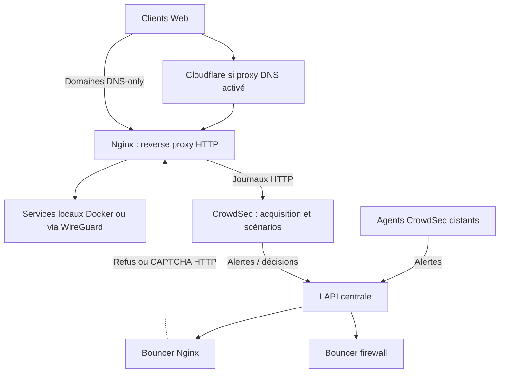

# CrowdSec et Nginx — détection et remédiation multi-serveurs

J'utilise **Nginx** sur un VPS frontal pour publier des services HTTP(S), avec **CrowdSec** pour détecter certains comportements suspects et transmettre des décisions aux composants de remédiation.

Nginx est ici exécuté dans l'image **SWAG (LinuxServer.io)** : elle facilite notamment les certificats TLS et l'intégration de modules Docker, mais le reverse proxy reste **Nginx**. Le conteneur Docker conserve le nom `swag` dans les commandes de diagnostic.

## Architecture et fonctions

- **Nginx** : reçoit et route les requêtes HTTP(S), journalise le trafic et exécute les vérifications du bouncer Lua lorsqu'il est chargé.
- **CrowdSec Security Engine** : acquiert les journaux, applique les parseurs/scénarios et transmet les alertes à la LAPI.
- **LAPI** : centralise les alertes/décisions ; les bouncers y récupèrent les décisions autorisées.
- **Bouncer Nginx** : agit au niveau HTTP (ban, CAPTCHA suivant configuration).
- **Bouncer firewall** : intervient au niveau réseau, sur les paquets qu'il voit réellement. Derrière Cloudflare, l'IP source réseau est celle du relais et ne devient pas automatiquement celle du visiteur.
- **Cloudflare** : se trouve en amont **seulement pour les domaines réellement proxifiés**. La chaîne `CF-Connecting-IP` / `real_ip_header` exige des plages de confiance restreintes et tenues à jour.

## Article et exemples techniques

- **[CrowdSec Web UI : supervision et sécurisation de l'interface](web-ui.md)** — retour d'expérience sur la LAPI, les identités techniques, Nginx/Authentik et les limites des preuves.\n- **[Nginx + CrowdSec : intégration et contrôles de sécurité](nginx-reverse-proxy.md)** — étude de cas alignée sur [l'article du blog](https://thadji.fr/crowdsec-nginx-swag-npm/), sans configuration privée.
- [Acquisition anonymisée des logs Nginx](../../examples/crowdsec/acquis.d/nginx.yaml)
- [Exemple Compose CrowdSec / LAPI / UI](../../examples/compose/crowdsec.compose.yaml)
- [Fragments de configuration Nginx](../../examples/nginx/README.md)
- [Matrice des validations et limites](../network-edge/validation.md)

## Résultats et prudence sur les preuves

Les contrôles d'exploitation déjà documentés montrent un **montage de logs en lecture seule**, une **configuration Nginx syntaxiquement valide**, des **références à CrowdSec et Real IP**, des **métriques CrowdSec** et des **compteurs de rejet relevés**. Ils ne prouvent **ni chaque scénario de détection, ni le filtrage effectif de tous les chemins**.

La validation complète implique une requête depuis une **IP de test contrôlée**, l'observation de la décision et de la réponse HTTP, puis la suppression de la décision. Les tests du firewall et ceux de Cloudflare doivent rester distincts.

Je ne publie **aucun secret LAPI, aucune configuration de bouncer réelle, aucune IP, aucun compte ni aucun relevé de trafic brut**. Les captures d'écran sont prévues pour une étape de documentation ultérieure.

Les exemples publics sont anonymisés et ne constituent pas une configuration Nginx/CrowdSec prête à être mise en production.
