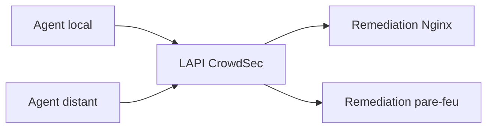

# CrowdSec : centraliser les événements et réagir

J'utilise **CrowdSec** pour traiter des événements de sécurité et appliquer des décisions via différents composants de remédiation. Dans une architecture multi-serveurs, une **LAPI centrale** permet à des agents de transmettre leurs événements et à des bouncers de récupérer des décisions.

J'ai observé de la **collecte de journaux**, des **alertes provenant d'un agent distant** et des compteurs de rejets côté Web et pare-feu. Je ne publie ni les compteurs détaillés ni la liste des agents, bouncers et décisions actives.

## Ce qu'un audit doit distinguer

- **Service démarré** : ne prouve ni collecte ni protection.
- **Agent enregistré** : ne prouve pas qu'il remonte des événements.
- **Bouncer enregistré** : ne prouve pas qu'il récupère ou applique correctement les décisions.
- **Compteur de rejet** : montre une activité, mais un test contrôlé reste nécessaire pour valider le chemin complet.

J'ai conservé les résultats d'exploitation détaillés hors du périmètre public. Les exemples de ce dépôt n'intègrent ni clé LAPI, ni configuration de remédiation réelle.

→ [Compose LAPI + UI](../../examples/compose/crowdsec.compose.yaml) · [Acquisition des logs Nginx](../../examples/crowdsec/acquis.d/nginx.yaml) · [Politique de publication](../../docs/publication-policy.md)
