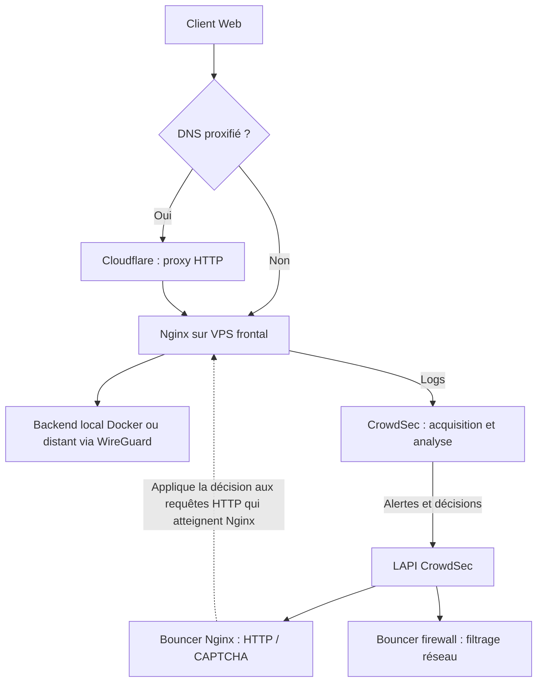

# Nginx et CrowdSec — détection et remédiation sur un VPS frontal

**Étude de cas technique anonymisée** · Article associé : [CrowdSec et Nginx : détecter et bloquer les attaques Web](https://thadji.fr/crowdsec-nginx-swag-npm/)

## Contexte et périmètre

J'utilise **Nginx comme reverse proxy HTTP(S)** sur un VPS frontal. Il tourne dans le conteneur **SWAG de LinuxServer.io**, qui fournit une installation Nginx avec gestion automatisée de certificats TLS et prise en charge de modules complémentaires (*Docker Mods*). Les fonctions de reverse proxy, les directives HTTP et le traitement des journaux restent ceux de **Nginx** ; SWAG n'est pas un autre moteur de proxy.

Certains domaines utilisent le proxy HTTP Cloudflare ; d'autres sont en DNS-only. Les applications peuvent être hébergées dans le réseau Docker du VPS ou sur des serveurs joints par WireGuard. Les flux non HTTP suivent des chemins différents et ne bénéficient pas automatiquement de la remédiation Nginx.



**Important :** un bouncer HTTP agit sur les requêtes reçues par Nginx ; le pare-feu agit sur les paquets effectivement vus par l'hôte. Derrière Cloudflare, le pare-feu du VPS voit normalement l'IP réseau du relais Cloudflare, tandis que Nginx peut restaurer l'IP visiteur pour ses journaux et contrôles HTTP. Il faut vérifier les deux chemins **séparément**.

## 1. Acquisition des logs Nginx

Le conteneur CrowdSec lit les fichiers journaux Nginx via un montage Docker **en lecture seule**. Un fichier d'acquisition déclare les chemins vus **dans le conteneur CrowdSec**, pas ceux de l'hôte.

Exemple de laboratoire :

```yaml
services:
  crowdsec:
    volumes:
      - /chemin/exemple/logs-nginx:/var/log/nginx:ro
```

Le fichier `acquis.d/nginx.yaml` peut ensuite référencer des fichiers présents sous `/var/log/nginx` avec le label `type: nginx`. Les chemins de l'hôte et les noms exacts de journaux doivent être adaptés et validés.

- [Exemple Compose anonymisé CrowdSec](../../examples/compose/crowdsec.compose.yaml)
- [Acquisition Nginx](../../examples/crowdsec/acquis.d/nginx.yaml)

Contrôles indicatifs, dans l'environnement de test :

```bash
docker exec crowdsec cscli metrics
docker exec crowdsec cscli collections list
docker exec crowdsec cscli alerts list
docker exec crowdsec cscli decisions list
```

**Différence fondamentale :** fichier lu → événements analysés → scénario déclenché → alerte/décision ne sont pas synonymes ; aucune de ces étapes ne prouve, isolément, le blocage client.

## 2. Nginx : bouncer HTTP et fonctionnement de la LAPI

Le **bouncer Nginx basé sur Lua** applique les décisions HTTP et, selon configuration, peut présenter une page de refus ou un CAPTCHA. Dans mon conteneur, le composant est chargé par le module `linuxserver/mods:swag-crowdsec` ; cela ne transforme pas les fonctions Nginx en fonctions spécifiques à SWAG.

```bash
docker exec crowdsec cscli bouncers list
docker exec swag nginx -t
docker exec swag nginx -T 2>&1 | grep -i crowdsec
docker logs --tail=80 swag
```

`swag` désigne ici **le nom du conteneur Docker**, pas un programme différent de Nginx. Il faut vérifier la compatibilité du module Lua avec la version Nginx après les mises à jour. Le chargement du module et l'enregistrement du bouncer doivent être confirmés séparément ; une inscription à la LAPI n'établit pas que chaque requête est filtrée.

Les modes du bouncer ont des implications différentes :

- **live** : consultation de la LAPI pour les vérifications non satisfaites par un cache valide ;
- **stream** : synchronisation périodique des décisions, puis évaluation locale.

Le mode et ses réglages doivent être choisis selon les besoins et contrôlés dans la version effective du bouncer. Aucune mesure comparative de performance n'est revendiquée ici.

## 3. Cloudflare et identité IP de l'utilisateur

Pour les domaines proxifiés, Nginx reçoit un flux provenant de Cloudflare, pas directement du navigateur. La restauration de l'IP source HTTP nécessite une **chaîne de confiance explicite** :

```nginx
# Inclure un fichier de confiance composé uniquement des plages
# IPv4 et IPv6 Cloudflare officielles, à maintenir à jour.
include /config/nginx/cloudflare-trusted-ranges.conf;
real_ip_header CF-Connecting-IP;
```

Le fichier d'include n'est **pas fourni ici** et doit contenir des directives `set_real_ip_from` adaptées au contexte Nginx. Ne jamais accepter `CF-Connecting-IP` de toutes les IP sources, car un client atteignant directement l'origine pourrait usurper l'adresse déclarée.

Contrôle minimal : `nginx -t`, revue de `nginx -T`, comparaison anonymisée de l'adresse journalisée lors d'un test contrôlé. **La détection de directives Real IP ne prouve pas que leur placement ni la provenance effective du trafic sont corrects.**

Cloudflare et le bouncer Nginx protègent des portions différentes du chemin HTTP ; une requête bloquée chez Cloudflare n'arrive pas au bouncer Nginx. Le filtrage du trafic DNS-only et des flux TCP/UDP doit être examiné séparément.

## 4. Ban HTTP, CAPTCHA et bouncer firewall

| Remédiation | Niveau d'action | Vérification représentative |
| --- | --- | --- |
| Bouncer Nginx | Requête HTTP reçue par Nginx | Réponse HTTP de refus ou CAPTCHA depuis une IP de test |
| Bouncer firewall | Paquets traversant les règles réseau de l'hôte | Connexion refusée sur le chemin réseau ciblé |
| Cloudflare | Proxy HTTP en amont pour les domaines proxifiés | Action des règles Cloudflare, si configurées |

Les modèles de pages de refus et de CAPTCHA sont chargés dans le conteneur Nginx ; leur rendu ne constitue pas une preuve de fonctionnement du firewall. Les secrets CAPTCHA et clés LAPI/bouncer restent privés.

## 5. Validation de bout en bout : travaux faits et limites

**Éléments déjà observés sur le VPS :**
- configuration Nginx valide au moment du contrôle `nginx -t` ;
- présence des directives CrowdSec et Real IP dans la configuration chargée ;
- montage lecture seule du répertoire de logs Nginx vers CrowdSec ;
- métriques de collecte CrowdSec, alertes provenant d'un agent distant et activité de rejet relevée.

**Ce qui ne doit pas être présenté comme prouvé :**
- validité de toutes les règles de confiance Cloudflare et des IP visiteurs enregistrées ;
- refus effectif de toute connexion interdite, y compris contournement direct/IPv6 ;
- fonctionnement de chaque bouncer, CAPTCHA ou décision sur un trajet réseau précis ;
- égalité des protections entre HTTP et flux non HTTP.

Pour démontrer un chemin complet, utiliser une adresse publique de test **que l'on contrôle**, distincte de l'accès principal d'administration, et un moyen de retour arrière :

1. confirmer l'acquisition avec `cscli metrics` ;
2. vérifier la présence du bouncer et des décisions dans la LAPI ;
3. créer une décision temporaire sur l'IP de test ;
4. observer la réponse depuis ce client sur une URL atteignant effectivement Nginx ;
5. supprimer la décision et confirmer le rétablissement de l'accès.

Les commandes de modification sont volontairement **non exécutées** dans ce dépôt. Les captures de validation seront ajoutées ultérieurement, une fois expurgées.

Voir la [matrice des vérifications réelles et ouvertes](../network-edge/validation.md). Les tests CI sur les exemples Nginx vérifient leurs chemins de laboratoire, **pas le fonctionnement réel des bouncers CrowdSec sur le VPS**.

## Sources techniques

- [Nginx — module Real IP](https://nginx.org/en/docs/http/ngx_http_realip_module.html)
- [Cloudflare — restaurer l'IP des visiteurs](https://developers.cloudflare.com/support/troubleshooting/restoring-visitor-ips/restoring-original-visitor-ips/)
- [CrowdSec — bouncer Nginx](https://docs.crowdsec.net/docs/bouncers/nginx/)
- [CrowdSec — bouncer firewall](https://docs.crowdsec.net/docs/bouncers/firewall/)
- [LinuxServer.io — SWAG, Nginx et certificats](https://docs.linuxserver.io/images/docker-swag/)
