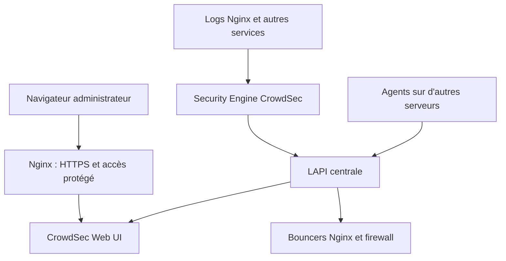

# CrowdSec Web UI : supervision des alertes et décisions

**Étude de cas documentée** · [Article publié sur thadji.fr](https://thadji.fr/crowdsec-web-ui-interface-gestion/)

## Pourquoi cette interface

J'utilise **CrowdSec Web UI** (projet TheDuffman85) comme outil de consultation et d'investigation associé à ma **LAPI CrowdSec centralisée sur un VPS**. L'interface ne remplace ni **CrowdSec Security Engine** (acquisition et détection), ni les **bouncers** (application des décisions aux flux réseau ou HTTP).

Le but est de retrouver plus facilement les **alertes, décisions et scénarios**, tout en conservant `cscli` et les journaux des services pour les diagnostics.



Le schéma illustre une séparation logique : le navigateur ne communique pas directement avec la LAPI, et l'interface Web **n'intercepte aucun trafic applicatif**.

## Connectivité et identités distinctes

Une erreur classique lors d'un déploiement Docker est de viser `127.0.0.1:8080` depuis le conteneur Web UI : cela désigne **son propre espace réseau**, et non CrowdSec. Si les conteneurs partagent le réseau approprié, le nom de service `crowdsec` peut permettre l'accès à `http://crowdsec:8080`. Cet exemple n'est valable que si l'écoute LAPI et les réseaux le permettent.

Il faut distinguer :
- l'identité **machine CrowdSec** utilisée par le Web UI pour accéder à la LAPI ;
- l'authentification **de l'utilisateur du tableau de bord** ;
- les **clés des bouncers**, qui servent aux composants de remédiation.

Les identifiants CrowdSec ne sont pas des comptes d'administration du navigateur. Ne jamais exposer la LAPI ou les secrets applicatifs directement à Internet.

## Évolution de la protection du tableau de bord

Au déploiement initial, mon interface était **publiée derrière Nginx et protégée par Authentik**. Nginx est exécuté dans une image Docker LinuxServer.io facilitant les certificats et modules complémentaires ; le proxy HTTP reste **Nginx**.

Les versions récentes de CrowdSec Web UI proposent aussi leur **propre authentification**, notamment des comptes locaux et des options OIDC. Je ne présente **pas** la migration vers cette authentification intégrée comme réalisée sur ma propre installation : elle reste à contrôler selon la version en fonctionnement et le stockage de configuration.

Attention : une protection placée seulement en frontal Nginx peut être contournée si un autre accès direct au conteneur reste ouvert depuis un réseau Docker non maîtrisé. L'absence de `ports:` dans un exemple Compose ne remplace pas une politique d'accès.

## Contrôles distincts

```bash
docker logs --tail=100 crowdsec-web-ui
docker exec crowdsec cscli machines list
docker exec crowdsec cscli alerts list
docker exec crowdsec cscli decisions list
docker exec crowdsec cscli bouncers list
docker exec crowdsec cscli metrics
```

Le nom `crowdsec-web-ui` ci-dessus est un exemple de nom de conteneur : l'adapter à la stack effectivement exécutée.

Une interface qui répond en HTTP **ne prouve pas** qu'elle synchronise correctement les données de la LAPI. Une décision visible dans l'interface **ne prouve pas** qu'un bouncer filtre le trafic attendu. La confirmation requiert des contrôles sur la LAPI, les journaux, puis un test contrôlé sur le chemin réseau concerné.

## Maintenance et anonymisation

Dans une installation Docker, les données persistantes et la configuration du Web UI doivent être sauvegardées conformément aux exigences de **la version réellement installée**, avant une mise à niveau. Les fonctions natives (OIDC, rôles, notifications, vues multi-instances) dépendent des versions et de leur configuration ; elles ne sont pas toutes revendiquées comme utilisées dans mon infrastructure.

Les exemples de ce dépôt restent des **reconstructions de laboratoire** : pas de secret LAPI, de compte réel, d'adresse d'administration, de base de données ou de fichier Compose de production. Les captures de validation sont prévues pour une étape ultérieure, après anonymisation.

Voir également :
- [Nginx + CrowdSec, remédiation HTTP et Cloudflare](nginx-reverse-proxy.md) ;
- [Compose CrowdSec/LAPI et Web UI anonymisé](../../examples/compose/crowdsec.compose.yaml) ;
- [Limites et validations déjà observées](../network-edge/validation.md).

## Documentation

- [CrowdSec — documentation des composants](https://docs.crowdsec.net/)
- [CrowdSec Web UI — code et documentation du projet](https://github.com/theduffman85/crowdsec-web-ui)
- [Nginx — documentation officielle](https://nginx.org/en/docs/)
