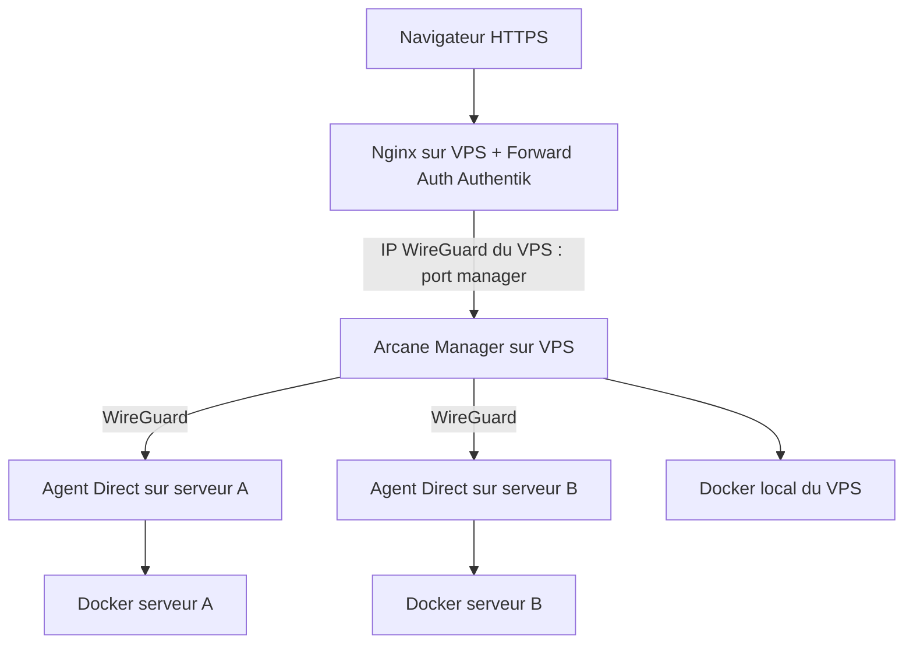

# Arcane : un point d'administration pour plusieurs serveurs Docker

J'utilise **Arcane** pour retrouver mes environnements Docker sans ouvrir une session SSH à chaque vérification. Le manager tourne sur mon **VPS Linux** et les autres serveurs disposent d'un **agent Arcane** qui administre leur Docker local.

Ce qui m'intéresse surtout : retrouver les projets Compose, lire les journaux, consulter les images, volumes et réseaux, puis intervenir sur le bon hôte. J'utilise toujours `docker compose` et SSH pour les opérations délicates, les incidents et les contrôles hors de portée de l'interface.

## Le trajet réseau que j'ai retenu

Les **ports publiés par Docker sont liés aux IP WireGuard des hôtes**, pas à `0.0.0.0` : le manager à celle du VPS, chaque agent Direct à celle du serveur distant. Dans le reverse proxy, Nginx cible **l'IP WireGuard du VPS**, et le manager joint les agents sur leurs IP WireGuard respectives.

Il y a deux chemins différents à ne pas confondre :

- **Nginx → manager** : Nginx et le manager étant sur le même VPS, cette communication reste **locale à ce serveur**, même si la destination est l'IP affectée à `wg0`.
- **Manager → agents** : cette communication entre hôtes utilise bien le **tunnel WireGuard**.

Un port publié sur une IP spécifique **réduit la surface d'exposition**, mais ne vaut pas règle de pare-feu. Le routage direct de Docker et le filtrage IPv4/IPv6 doivent être contrôlés séparément. Cette méthode ne consiste pas à monter l'interface `wg0` dans un conteneur.

## Accès Web et privilèges

J'ai placé le tableau de bord derrière **Nginx**, avec **Authentik** pour contrôler l'accès : OIDC côté connexion à l'application, Forward Auth côté proxy. L'accès est destiné à un compte d'administration autorisé. Je ne publie ni les URL internes, ni les politiques exactes, ni les jetons des agents.

Le **socket Docker** est le point de risque le plus important : Arcane et ses agents disposent de capacités élevées sur leurs hôtes. La sécurité du compte Web ne remplace pas les restrictions réseau, la protection des jetons, les mises à jour et un accès SSH indépendant pour le dépannage.

## Exemples publics

Ce dépôt ne reproduit pas mes fichiers de production :

- [Compose du manager](../../examples/compose/arcane.compose.yaml) : `host_ip` configurable, socket Docker, données persistantes et chemin des projets.
- [Compose d'un agent Direct](../../examples/compose/arcane-agent.example.yaml) : binding sur l'IP WireGuard du serveur distant, jeton fourni hors dépôt.
- [Nginx et Authentik](../../examples/nginx/arcane-authentik.subdomain.conf) : upstream **fictif** représentant l'IP WireGuard du VPS et include Forward Auth.
- [Architecture Nginx et Compose](../../examples/compose/README.md) : limites du modèle et validation des fragments.
- [Gestion des accès Authentik](../identity-access/README.md).

La valeur `192.0.2.10` dans l'exemple Nginx est une **adresse réservée à la documentation**, jamais l'adresse d'un de mes serveurs.

## Contrôles encore à réaliser

Je distingue les fonctionnalités que j'utilise des tests de sécurité qui restent à formaliser. Avant de considérer l'accès comme correctement isolé, il faut mesurer :

1. la portée réelle des ports manager/agents, depuis le VPN et depuis un réseau non autorisé ;
2. l'accès **refusé** au backend direct contournant Nginx / Authentik ;
3. les réponses obtenues avec un compte autorisé, non autorisé et déconnecté ;
4. la connectivité manager → agent après application du pare-feu ;
5. la reprise d'administration par SSH si Arcane ou son manager est indisponible.

La capture de l'interface existante reste privée tant que ses noms, données et éventuels secrets n'ont pas été masqués. Les exemples publics et leurs tests Nginx **ne prouvent pas** l'isolation du déploiement réel.

[Documentation Arcane : environnements distants](https://getarcane.app/docs/remote/environments) · [Documentation Docker : publication de ports](https://docs.docker.com/engine/network/port-publishing/) · [Blog thadji.fr](https://thadji.fr/)
