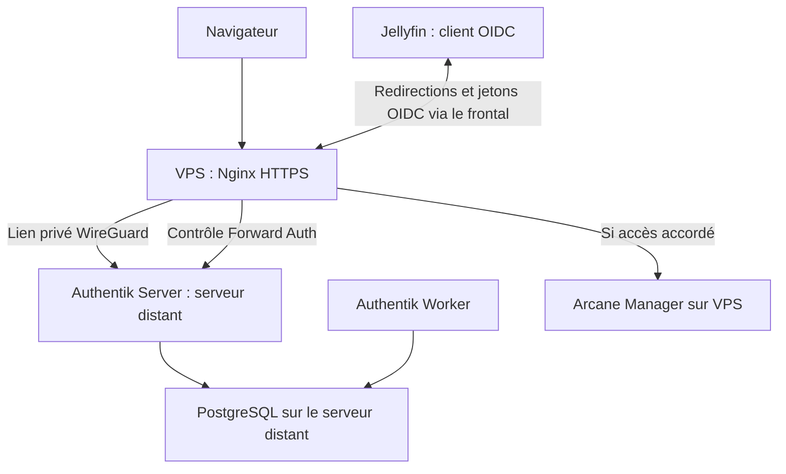

# Authentik : SSO et contrôle d'accès entre plusieurs serveurs Linux

J'ai centralisé l'authentification de plusieurs applications avec **Authentik**. L'instance ne tourne pas sur mon VPS frontal : elle est hébergée sur **un autre serveur Linux**. Le VPS reçoit les requêtes HTTPS avec **Nginx**, puis rejoint Authentik par **WireGuard**.

Mon objectif n'est pas d'ouvrir tous les services à toute personne connectée. Selon l'application, je limite l'accès **à un utilisateur précis** ou **à un groupe autorisé**.

Ce document est lié à mon article technique sur [thadji.fr](https://thadji.fr/). Le dépôt contient des explications et des exemples anonymisés, pas mes règles IAM, mes domaines ou mes fichiers de production.

## Mon choix : OIDC, LDAP ou Forward Auth

Je privilégie les protocoles pris en charge nativement par le logiciel :

| Méthode | Dans quel cas ? | Usage documenté |
|---|---|---|
| **OpenID Connect (OIDC)** | L'application sait rediriger vers un fournisseur d'identité et exploiter ses jetons/claims | **Jellyfin**, avec le plugin SSO-Auth |
| **LDAP** | Pas d'OIDC, mais le logiciel peut consulter un annuaire | **Possibilité étudiée, non activée actuellement** |
| **Forward Auth (Nginx)** | Ni OIDC ni LDAP côté application, ou contrôle d'accès voulu au niveau du proxy | **Arcane**, avec un Proxy Provider dédié |

LDAP n'est pas automatiquement synonyme de SSO Web : il peut centraliser l'authentification à un annuaire sans offrir la même session par redirection qu'OIDC. Authentik peut **présenter un service LDAP** aux applications compatibles via provider/outpost, ou **consommer un LDAP/Active Directory existant** comme source d'identités. Ce sont deux rôles distincts ; je ne présente aucun de ces deux montages comme étant déjà en service.

## Architecture

Le dessin est logique, pas une capture de routes ni un export de la topologie. Dans le cas d'Arcane, **Nginx et le manager sont sur le même VPS** : Nginx atteint l'adresse WireGuard **locale** du VPS pour joindre le manager. En revanche, les échanges Nginx → Authentik traversent bien le **tunnel entre deux hôtes**.

La stack Authentik fournie comprend **PostgreSQL**, un service `server` et un `worker` distinct. PostgreSQL possède un healthcheck et les données sont persistées dans des volumes. Le Compose source expose deux ports au niveau de l'hôte sans bind IP explicite : l'accès effectif dépend des routes, du firewall, de Docker et du routeur. **Ne pas en déduire un filtrage WireGuard exclusif.** Le worker fonctionne avec des droits élevés dans la configuration fournie ; le montage du socket Docker y était commenté. Les chemins de templates du serveur et du worker doivent aussi être comparés avant toute modification.

→ [Étude de l'architecture Docker/Nginx et des points de contrôle](architecture-nginx.md)

## Exemple 1 — Arcane : Forward Auth par application

J'utilise un **Proxy Provider en mode « Forward Auth (single application) »**. Le VPS reçoit la requête HTTP(S) pour Arcane, interroge l'Outpost Authentik avec `auth_request`, puis laisse Nginx transmettre la requête à Arcane **si l'autorisation est accordée**.

Dans mon installation, l'application Arcane est liée à **un seul compte d'administration**. Le mode de politiques affiché est `ANY` ; avec une seule liaison active, cela restreint le périmètre voulu, mais l'ajout d'une autre liaison pourrait élargir l'accès.

J'ai choisi le **mode application unique** plutôt qu'une règle générale au niveau du domaine, car chaque application doit pouvoir conserver ses propres autorisations.

Cela reste du **contrôle d'accès au niveau du proxy** : Arcane ne devient pas automatiquement un client OIDC natif, et les ports permettant de contourner Nginx doivent être filtrés.

- [Exemple Nginx Arcane + Authentik déjà présent](../../examples/nginx/arcane-authentik.subdomain.conf)
- [Réseau WireGuard du manager et de ses agents](../docker-management/README.md)

## Exemple 2 — Jellyfin : connexion OIDC native

Jellyfin est l'exemple concret que j'ai retenu pour montrer **OIDC**, via le plugin SSO-Auth. Authentik émet les informations d'identité, puis **Jellyfin interprète les claims** et crée sa session applicative.

L'accès est destiné aux membres d'un **groupe autorisé** dans Authentik. Le plugin Jellyfin utilise les claims de groupe pour attribuer les privilèges pertinents, notamment un groupe d'administration distinct. Il faut séparer :

- **Autorisation dans Authentik** : qui peut utiliser cette application OIDC ?
- **Validation OIDC dans Jellyfin** : jetons, issuer, audience, redirections et compte local.
- **Permissions Jellyfin** : administration, bibliothèques et fonctionnalités.

Un groupe affiché dans le catalogue de l'interface Authentik n'est pas nécessairement la politique d'autorisation elle-même. Les captures de configuration ont été préparées et anonymisées pour le blog ; aucun `client_id`, secret client, URL ou groupe de production n'est recopié ici.

Le même principe peut s'appliquer à d'autres logiciels compatibles OIDC, par exemple **Nextcloud** avec un module adapté ; je ne prétends pas que tous ces logiciels soient déjà configurés dans cette installation.

## Défense complémentaire : CrowdSec et Authentik

J'ai ajouté une **collection communautaire Authentik depuis CrowdSec Hub** pour détecter des tentatives répétées de connexion, en complément des mécanismes natifs d'Authentik. CrowdSec dispose d'un accès **en lecture seule** aux journaux du conteneur Authentik.

Le chemin exact d'acquisition (journaux Docker, fichier, agent, source distante) et le nom de la collection ne figurent pas dans les fichiers transmis : je ne les invente pas. La collection `firix/authentik` existe sur le Hub et contient parseur et détection brute force ; sa présence exacte chez moi restera à confirmer séparément.

Il faut distinguer **collecte**, **parsing**, **scénario déclenché**, **décision de la LAPI** et **application par un bouncer**. Pour un domaine proxifié par Cloudflare, la bonne attribution de l'IP visiteur dépend aussi de la chaîne de confiance des en-têtes, et le bouncer réseau ne voit pas nécessairement l'IP originale.

→ [Chaîne de vérification CrowdSec/Authentik](crowdsec-authentik.md) · [CrowdSec sur mon infrastructure](../crowdsec/README.md)

## Ce que j'ai contrôlé, ce qu'il reste à tester

| Point | Fondement | Limite |
|---|---|---|
| Compose PostgreSQL / Server / Worker | Fichier source de l'installation transmis | Pas de test de redémarrage/restauration |
| Nginx vers Authentik en HTTPS sur une IP privée | Extraits réels des includes et du proxy | Validation TLS de l'upstream à contrôler séparément |
| Forward Auth Nginx activé sur Arcane | Includes présents dans la configuration | Refus et contournement du backend à tester |
| Provider Arcane « application unique » | Capture de la configuration | Autorisation d'un compte différent à tester |
| OIDC pour Jellyfin | Captures du provider et du plugin | Contrôle issuer/claims/groupe et refus à tester |
| Anti-bruteforce CrowdSec | Configuration décrite par l'auteur | Logs acquis, scénario et bouncer à contrôler bout en bout |

Les captures sont intégrées à l'article WordPress après anonymisation ; elles ne sont **pas** un export de la configuration, ni une preuve de toutes les propriétés de sécurité.

## Documentation utile

- [Authentik — Forward Auth](https://docs.goauthentik.io/add-secure-apps/providers/proxy/forward_auth)
- [Authentik — OIDC](https://docs.goauthentik.io/add-secure-apps/providers/oauth2/)
- [Authentik — LDAP](https://docs.goauthentik.io/add-secure-apps/providers/ldap/)
- [Collection Authentik communautaire sur CrowdSec Hub](https://app.crowdsec.net/hub/author/firix/collections/authentik)
- [Article et autres retours d'expérience](https://thadji.fr/)
