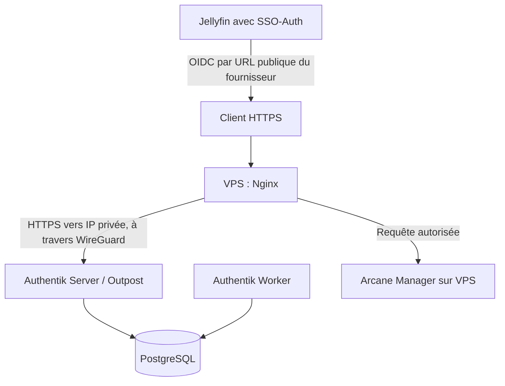

# Authentik derrière Nginx et WireGuard : relevé d'architecture

Je sépare ici **les observations faites sur les fichiers transmis**, les **explications de fonctionnement** et les **points qui exigent encore un test**. Cette page accompagne le [retour d'expérience Authentik](README.md).

## 1. Où se trouvent les composants ?

- **VPS public** : Nginx reçoit les connexions HTTPS et sert de reverse proxy.
- **Serveur Linux distant** : conteneurs PostgreSQL, Authentik Server, Authentik Worker.
- **WireGuard** : liaison privée entre le VPS et le serveur Authentik.
- **Arcane Manager** : sur le VPS, accessible à Nginx par le port publié sur **l'IP WireGuard du VPS**.
- **Jellyfin** : client OIDC qui utilise Authentik comme fournisseur d'identité ; l'emplacement réseau de Jellyfin n'est pas précisé ici.



Ce schéma est fonctionnel. Il ne révèle ni la topologie IP ni les règles de filtrage. Une application OIDC ne doit pas être présentée comme étant protégée par `auth_request` si elle gère elle-même sa connexion via son plugin.

## 2. Les fichiers Nginx observés

Trois morceaux ont été fournis :

1. `proxy-confs/authentik.subdomain.conf` : publication du **portail Authentik** par Nginx, avec `proxy_pass` vers l'adresse VPN du serveur distant et son port HTTPS.
2. `nginx/authentik-server.conf` : location `/outpost.goauthentik.io`, sous-requête `/outpost.goauthentik.io/auth/nginx` marquée `internal`, gestion des cookies et redirection après refus `401`.
3. `nginx/authentik-location.conf` : directive `auth_request`, extraction des en-têtes d'identité et transmission à l'application autorisée.

Le `proxy-confs/arcane.subdomain.conf` fourni inclut `authentik-server.conf` au niveau `server` et `authentik-location.conf` dans `location /`. Il configure ensuite son backend sur l'**IP WireGuard du VPS** avec le port du manager. C'est bien du **Forward Auth via Nginx**, pas une preuve de connexion OIDC native d'Arcane.

### Illustration anonymisée du chemin réseau

Les deux adresses ci-dessous appartiennent à la plage **RFC 5737 réservée à la documentation**. Elles ne sont pas routables vers mes machines et ne doivent pas être copiées directement dans Nginx :

```nginx
# Fragment illustratif : sous-requête Outpost vers Authentik distant.
# Le code réel est dans les includes Nginx, non repris tel quel.
set $upstream_authentik 192.0.2.20;  # placeholder : adresse WireGuard distante
proxy_pass https://$upstream_authentik:9443;
```

```nginx
# Fragment illustratif : Arcane sur le même VPS que Nginx.
# Destination = IP WireGuard LOCALE du VPS, pas l'IP de l'agent distant.
set $upstream_app 192.0.2.10;       # placeholder : IP WireGuard du VPS
set $upstream_port 3552;
set $upstream_proto http;
proxy_pass $upstream_proto://$upstream_app:$upstream_port;
```

L'exemple Nginx réellement maintenu dans ce dépôt se trouve dans [`arcane-authentik.subdomain.conf`](../../examples/nginx/arcane-authentik.subdomain.conf). Il remplace la destination par une IP fictive, ne reproduit pas les policies de l'IdP et a été adapté aux tests du dépôt. Les snippets de cette page **ne forment pas deux configurations Nginx complètes**.

## 3. Le déroulement du Forward Auth Arcane

1. Un navigateur demande l'URL HTTPS d'Arcane au VPS.
2. Nginx appelle l'endpoint Authentik `/outpost.goauthentik.io/auth/nginx` comme **sous-requête interne**.
3. L'Outpost Authentik renvoie une réponse correspondant à la session et à l'autorisation.
4. Nginx autorise le passage pour une réponse `2xx`. Sur `401`, la configuration observée prépare une redirection vers le portail ; `403` n'est pas une autorisation.
5. Seules les requêtes acceptées sont ensuite transmises au backend Arcane.

Le provider de l'application est en mode **Forward Auth (single application)**. Authentik permet ainsi de définir des bindings propres à Arcane : dans le cas documenté, un compte d'administration unique. Le moteur de politiques est en mode `ANY`, ce qui oblige à surveiller les autres liaisons si elles changent.

La présence des includes montre le mécanisme **configuré**, pas les résultats d'un test de refus, ni l'impossibilité d'atteindre le port Arcane autrement.

## 4. Une vraie limite : vérification TLS sur le backend Authentik

`proxy_pass https://...` active TLS vers Authentik, mais **n'établit pas à lui seul la vérification de l'identité du serveur**. Nginx ne vérifie pas les certificats des upstreams par défaut sans `proxy_ssl_verify on` et un magasin de confiance approprié.

Quand l'upstream est **une IP VPN**, il faut également définir correctement le nom de vérification et le SNI si nécessaire. Les paramètres peuvent dépendre des certificats utilisés ; je ne publie donc pas un bloc `proxy_ssl_*` supposé fonctionner partout.

Il faut vérifier la configuration chargée et réaliser un test sécurisé avant d'affirmer que le certificat Authentik est validé. Une erreur peut produire une connexion chiffrée **sans authentification cryptographique du serveur cible**.

## 5. Le Compose Authentik fourni : faits et points ouverts

| Observation | Signification / limite |
|---|---|
| PostgreSQL 16 dans un conteneur distinct, healthcheck | Le serveur attend une déclaration `healthy`, pas une preuve de cohérence des données |
| Deux commandes Authentik : `server` et `worker` | Rôles distincts, partageant la même base |
| Volumes persistants de données et templates | Les chemins de templates du serveur et worker **ne sont pas identiques** dans le fichier transmis |
| Publication des ports hôte sans IP explicite | Docker écoute normalement sur plusieurs interfaces ; le firewall et les routes effectives restent à vérifier |
| Worker lancé en root et socket Docker commenté | Le montage de `docker.sock` n'est pas actif dans ce Compose ; la nécessité de root est à réévaluer avec les permissions des volumes |

La liaison VPN évite une redirection de port entrant au routeur du site, mais ne rend pas magiquement un port Docker inaccessible depuis le LAN ou une autre interface autorisée.

## 6. Tests avant toute conclusion de sécurité

- Depuis un compte contrôlé **non lié à Arcane**, vérifier le refus (et comparer à un compte autorisé).
- Depuis une origine non autorisée, tenter l'accès direct au backend pour détecter un contournement de Nginx.
- Inspecter la configuration effective `nginx -T` et l'état de `proxy_ssl_verify` sans diffuser les IP/domaines réels.
- Vérifier le traitement des cookies, en-têtes de confiance et chemins `/outpost.goauthentik.io`.
- Contrôler le firewall des deux hôtes, l'exposition Docker IPv4/IPv6 et les droits sur les volumes.
- Pour Jellyfin, vérifier séparément le refus d'un membre **hors du groupe autorisé** et les droits d'administration/bibliothèques après connexion OIDC.

Références : [Authentik Forward Auth](https://docs.goauthentik.io/add-secure-apps/providers/proxy/forward_auth), [Nginx auth_request](https://nginx.org/en/docs/http/ngx_http_auth_request_module.html), [Nginx proxy SSL](https://nginx.org/en/docs/http/ngx_http_proxy_module.html#proxy_ssl_verify), [Documentation réseau](../network-edge/README.md).
