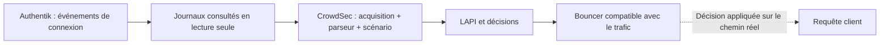

# Authentik + CrowdSec : détecter les tentatives de brute force

Sur mon déploiement Authentik, j'ai ajouté une **analyse des tentatives de connexion** avec CrowdSec, en complément des protections internes d'Authentik. Je consulte les journaux du conteneur Authentik depuis CrowdSec **en lecture seule**.

Je ne présente pas cette couche comme un remplacement de l'authentification MFA, des contrôles d'autorisation ou des politiques d'accès Authentik. Elle vise une autre partie du problème : **détecter certains comportements répétés puis, si la chaîne est opérationnelle, déclencher une décision de remédiation**.

## Les composants



La collecte des journaux ne démontre **pas** qu'un bouncer bloque une source donnée. Il faut que le parseur comprenne le format des événements, que le scénario soit déclenché, qu'une décision soit transmise à la LAPI, puis qu'un bouncer agisse sur le trafic pertinent.

## Collection communautaire

J'ai installé une collection Authentik d'un contributeur indépendant depuis **CrowdSec Hub**. Le nom exact de la collection installée n'a pas été communiqué ; il ne doit pas être deviné à partir de la seule description.

Une collection disponible publiquement est [`firix/authentik` — Authentik Bruteforce Protection](https://app.crowdsec.net/hub/author/firix/collections/authentik), qui fournit un **parseur Authentik** et un **scénario de détection de brute force**. La disponibilité sur le Hub ne prouve ni son installation sur mon agent ni la compatibilité automatique avec ma version des journaux.

## Comment vérifier sans exposer mes logs

Sur l'agent CrowdSec qui acquiert les événements, les commandes de diagnostic utiles comprennent :

```bash
# Sur l'hôte / conteneur où les commandes CrowdSec sont disponibles
cscli collections list
cscli metrics
cscli scenarios list
```

Ce sont **des commandes d'inspection** ; leurs sorties peuvent contenir des informations sensibles et ne doivent pas être copiées telles quelles dans le dépôt public.

Je veux documenter séparément :

| Étape | Ce qu'il faut établir | Statut public |
|---|---|---|
| Accès aux logs Authentik | Source lisible sans donner un accès d'écriture inutile | Principe décrit par l'auteur ; montage exact non fourni |
| Collection communautaire | Nom et version réellement installés | À relever |
| Parsing | Compteurs de lignes acquises et parsées pour Authentik | À vérifier |
| Détection | Événement de test contrôlé reconnu par le scénario | À vérifier |
| Décision LAPI | Décision temporaire correspondant au test | À vérifier |
| Bouncer | Blocage réellement observé sur une origine de test | À vérifier |

## Attention à Cloudflare et à l'IP cliente

Pour les domaines proxifiés par Cloudflare, le **paquet TCP reçu sur le VPS** peut provenir d'une IP Cloudflare plutôt que de l'IP du navigateur. Nginx peut restaurer une IP cliente dans ses journaux HTTP si la chaîne de confiance est configurée correctement ; cela ne change **pas** automatiquement l'IP source des paquets vue par un bouncer firewall.

Il faut donc vérifier **quel bouncer agit**, sur **quel composant**, et **quelle IP** il prend pour cible. Une décision lue dans la LAPI n'est pas une preuve que le client a été bloqué.

## Sécurité du test

Pour éviter de verrouiller une adresse légitime ou d'altérer des services publics, les essais doivent utiliser une **source contrôlée et autorisée**, une décision courte et un nettoyage explicite de l'état de test. Ne pas publier les journaux bruts, secrets d'authentification, véritables IP ou règles de production.

Liens :
- [Architecture Authentik / Nginx / WireGuard](architecture-nginx.md)
- [Étude de cas Authentik principale](README.md)
- [CrowdSec, LAPI et bouncers](../crowdsec/README.md)
- [Documentation CrowdSec Hub](https://docs.crowdsec.net/u/getting_started/installation/crowdsec/)
