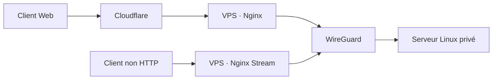

# Exposer des services via un VPS frontal

J'utilise un VPS comme **point d'entrée**, pour éviter de publier directement des services sur les adresses Internet des serveurs on-premises.

C'est une **vue fonctionnelle**, pas un plan d'adressage ni une preuve de segmentation.

## Deux chemins selon le protocole

**Web :** Cloudflare ne précède Nginx que pour les noms DNS effectivement proxifiés. Le VPS reçoit ensuite la requête HTTP(S) et l'achemine vers un backend.

**TCP/UDP :** Nginx Stream permet d'acheminer certains protocoles non HTTP. Ces flux ne bénéficient pas automatiquement des protections du proxy HTTP Cloudflare.

Pour un service hébergé **localement sur le VPS**, Nginx peut utiliser le **DNS interne Docker + port du conteneur** sur un réseau partagé. Pour un service hébergé **sur un autre serveur**, le backend est adressé via **WireGuard et son port applicatif**. Je ne publie ni les IP ni les ports réels des services distants.

## Ce qu'il faut tester

- Un chemin complet depuis un client autorisé jusqu'au backend.
- Le refus d'une connexion non autorisée ou d'un chemin direct contournant le proxy.
- Le filtrage IPv4 **et** IPv6 sur le serveur frontal.
- La chaîne de confiance des en-têtes d'IP client derrière Cloudflare.
- Les certificats, les redirections et les services sensibles.

**Attention :** un VPN chiffré n'est pas une règle de pare-feu ; la segmentation doit être configurée et testée séparément.

→ [Nginx : reverse proxy HTTP + Stream multi-protocole anonymisés](../../examples/nginx/README.md) · [Sécurité de publication](../../docs/publication-policy.md)
