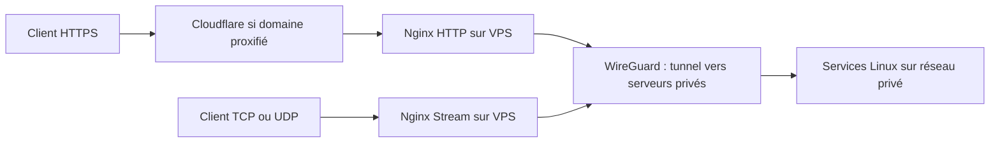

# Nginx Stream + WireGuard : publier TCP et UDP via un VPS

**Retour d'expérience anonymisé** · [Article technique thadji.fr](https://thadji.fr/exposer-des-services-tcp-udp-on-premises-sans-ouvrir-de-ports/)

## Pourquoi Stream ?

Je publie les applications HTTP(S) avec **Nginx HTTP**, et certains protocoles non HTTP avec **Nginx Stream**, sur le même VPS frontal. Les serveurs Linux distants sont joints par WireGuard : aucune redirection de port entrant n'est nécessaire sur les routeurs des sites privés, tandis que les **ports nécessaires restent publics sur le VPS**.

Nginx est exécuté dans une image Docker **SWAG de LinuxServer.io** (certificats automatiques et possibilité d'ajouter des modules). Ce n'est pas un autre moteur : les directives et modules décrits sont ceux de Nginx.

## Architecture fonctionnelle

Un service local au VPS peut être joint par **nom DNS Docker + port de conteneur**. Un service distant utilise l'**adresse privée WireGuard + port applicatif**. Le schéma ne démontre pas les règles de pare-feu effectives.

## Différence HTTP / Stream

- **HTTP(S)** : `server_name`, `location`, `proxy_pass http://...`, en-têtes et protections HTTP.
- **Stream TCP** : `stream { server { listen PORT; proxy_pass upstream; } }`, transfert d'un flux octet par octet.
- **Stream UDP** : `listen PORT udp;` et publication du même port **en UDP** dans Docker.
- **WireGuard** : transport chiffré entre les hôtes ; il ne fournit pas les règles d'accès applicatives.

Le bloc `stream {}` se place au niveau principal de Nginx, **pas dans `http {}`**. Ne pas en créer un deuxième si le fichier principal en inclut déjà un.

Les fragments du dépôt utilisent des **adresses réservées à la documentation**, pas les adresses WireGuard réelles :
- [Architecture et test des exemples](../../examples/nginx/README.md)
- [Relais TCP messagerie](../../examples/nginx/stream-confs/mail-relay.conf)
- [Relais UDP/TCP voix](../../examples/nginx/stream-confs/voice-relay.conf)
- [Inclusion Stream](../../examples/nginx/stream.conf)

## Messagerie : TCP passthrough et PROXY protocol

Pour la messagerie, le relais TCP laisse SMTP, STARTTLS et TLS être gérés par le service destinataire ; Nginx Stream n'implique **pas une terminaison TLS**.

Le **PROXY protocol** est une option distincte permettant d'envoyer des informations sur le client à un backend qui **sait les lire**. Dans le module Stream Nginx, `proxy_protocol on;` **émet** l'en-tête vers l'upstream ; `listen ... proxy_protocol` **attend** cet en-tête côté entrée. Activer la seconde directive sur un port destiné aux clients Internet ordinaires casserait leur connexion.

Les relevés passifs documentés confirment l'émission PROXY protocol sur un relais SMTP Nginx ainsi que l'existence d'écoutes Postfix dédiées acceptant le format HAProxy. **La correspondance effective entre l'upstream Nginx, les ports publiés Docker et ces écoutes reste à vérifier** : ne pas revendiquer un succès de bout en bout sans ce contrôle. Ne pas étendre cette configuration automatiquement à SMTPS, Submission, IMAP ou aux flux UDP.

## UDP et publication Docker

Pour un service vocal, les règles doivent coïncider entre l'écoute Nginx, le mapping Docker `/udp`, le pare-feu IPv4/IPv6 du VPS et la destination WireGuard. Une publication TCP d'un même numéro de port ne publie pas automatiquement l'UDP.

La lecture de `nginx -T` ou un test `nginx -t` ne démontre que l'état de la configuration ; le bon fonctionnement exige un échange applicatif adapté au protocole.

## Sécurité : limites selon le trajet

- Le **proxy HTTP Cloudflare** ne protège pas automatiquement les connexions TCP/UDP non HTTP.
- Le **bouncer HTTP CrowdSec dans Nginx** ne filtre pas implicitement les flux Stream ; le firewall et les protections applicatives doivent être vérifiés à part.
- Un tunnel WireGuard actif ne garantit ni la segmentation inter-serveurs ni les refus de connexion.
- **La restauration de l'IP cliente** derrière Cloudflare et le **PROXY protocol TCP** sont deux mécanismes différents.

## Validation et travaux ouverts

Les audits déjà réalisés en lecture seule ont confirmé la présence des blocs Nginx HTTP/Stream et une configuration acceptée par Nginx. Les tests CI du dépôt vérifient les **exemples publics** avec des backends locaux simulés, sans toucher aux applications privées.

Restent distinctement à valider sur l'environnement réel : chemin client TCP vers le backend ; chemin client UDP ; concordance des écoutes Postfix/Docker/Nginx ; politique de filtrage et de retour des flux.

Références :
- [Matrice des observations, tests et limites](validation.md)
- [Article WireGuard VPS / on-premises](wireguard-vps-onprem.md)
- [Documentation Nginx Stream](https://nginx.org/en/docs/stream/ngx_stream_proxy_module.html)
- [Nginx Stream Core](https://nginx.org/en/docs/stream/ngx_stream_core_module.html)

**Confidentialité :** aucun fichier de production, domaine réel, secret, IP ou relevé exhaustif de ports et de flux n'est reproduit dans ce document. Les captures seront ajoutées au blog à l'étape finale.
