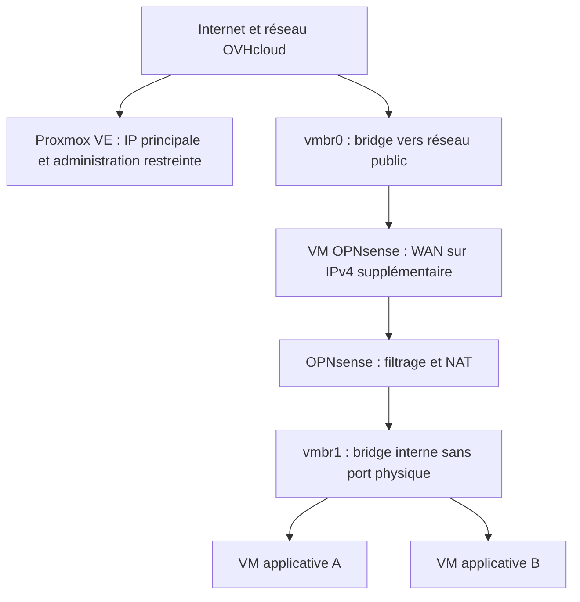

# Proxmox VE et OPNsense sur OVHcloud — retour d'expérience historique

**Ancienne architecture, non exploitée actuellement** · [Article de blog : Proxmox et OPNsense sur OVHcloud](https://thadji.fr/proxmox-opnsense-ip-failover-ovh/)

## Contexte

J'ai précédemment exploité une architecture de virtualisation avec **Proxmox VE** sur un serveur dédié OVHcloud et une **machine virtuelle OPNsense** chargée du routage et du filtrage d'un réseau de VM. Ce retour d'expérience décrit cette période ; il ne correspond **pas à l'architecture Linux/Docker actuelle** décrite dans les autres projets du dépôt.

Les objectifs étaient :
- séparer **l'administration de l'hyperviseur** de la **publication des services** ;
- conserver une IP principale pour l'hôte Proxmox avec accès d'administration restreint ;
- utiliser une **IPv4 supplémentaire** OVHcloud pour la VM OPNsense et le trafic des services ;
- relier les VM à un réseau interne et centraliser leur routage/NAT dans OPNsense.

## Vue logique anonymisée

La séparation **WAN/LAN** doit être distinguée de la **segmentation entre deux VM du même LAN** : deux VM sur le même bridge interne peuvent échanger des trames localement sans traverser OPNsense. Une vraie segmentation latérale nécessite des réseaux distincts et des règles adaptées (VLAN, filtrage hyperviseur ou autre stratégie explicitement testée).

## IPv4 supplémentaire OVHcloud et MAC virtuelle

Dans le mode réseau historiquement employé, une IPv4 supplémentaire était **associée à une MAC virtuelle** utilisée par la carte WAN de la VM OPNsense. Le câblage logique, les paramètres /32 et le routage doivent dépendre du **mode OVHcloud réellement fourni** : il ne faut pas copier mécaniquement cette solution vers un autre modèle de réseau ou un déploiement vRack.

Ce dépôt ne publie pas la vraie adresse IP, la MAC, la passerelle, les routes, les VLAN éventuels ni les règles de filtrage originales. Les illustrations et exemples de l'article ne doivent pas être traités comme une configuration de production prête à appliquer.

## Protéger l'hyperviseur indépendamment d'OPNsense

L'accès à **Proxmox VE sur TCP/8006** était restreint au niveau de l'hôte afin de ne pas dépendre de l'état de la VM OPNsense pour contrôler l'administration. Une règle affichée ou chargée ne garantit pas, à elle seule, l'effectivité de la protection.

Un contrôle fiable distingue :
1. l'écoute et la configuration du firewall Proxmox, y compris son activation aux niveaux pertinents ;
2. une connexion depuis la source d'administration autorisée ;
3. un essai refusé depuis une autre source contrôlée ;
4. la connectivité et l'accès de secours avant changement de bridge ou de route.

## Routage et filtrage des VM

OPNsense servait de **passerelle aux VM** du réseau interne et gérait les règles WAN/LAN ainsi que le NAT approprié. J'avais également travaillé avec une intégration **CrowdSec / firewall**, sans assimiler la présence d'une décision LAPI à un blocage démontré sur le trajet réel.

Un audit complet devrait vérifier séparément :
- connectivité WAN et route par défaut de la VM OPNsense ;
- accès des VM internes à leurs destinations autorisées ;
- refus depuis un réseau source non autorisé ;
- absence de chemin direct de contournement ;
- cohérence du firewall Proxmox et de celui d'OPNsense ;
- application effective des décisions CrowdSec si cette fonction est activée.

Les résultats bruts de ces tests historiques ne sont **pas publiés**. Ce document ne prétend ni mesurer une conformité passée, ni valider les paramètres de l'ancien déploiement à posteriori.

## Retour d'expérience et limites

Cette architecture m'a familiarisé avec le **routage d'une IPv4 supplémentaire**, les bridges Proxmox, les limites de la segmentation de couche 2, le NAT et la séparation des périmètres d'administration.

Elle créait aussi des dépendances : la VM OPNsense était une passerelle critique pour les autres VM, et une erreur sur le réseau public de Proxmox pouvait couper l'administration à distance. La redondance disque ne remplace pas les sauvegardes ; le firewall virtualisé ne remplace pas une politique d'accès correctement vérifiée.

**Évolution :** je ne présente pas cette architecture historique comme mon infrastructure actuelle. Le portfolio décrit désormais surtout des serveurs Linux, des conteneurs Docker, un frontal Nginx et des liaisons WireGuard.

## Documentation

- [Proxmox VE : documentation](https://pve.proxmox.com/pve-docs/)
- [OPNsense : documentation](https://docs.opnsense.org/)
- [OVHcloud : documentation réseau](https://help.ovhcloud.com/)
- [CrowdSec : documentation](https://docs.crowdsec.net/)

**Publication :** les captures du blog sont conservées sur WordPress ; seules les références et les explications anonymisées figurent ici.
