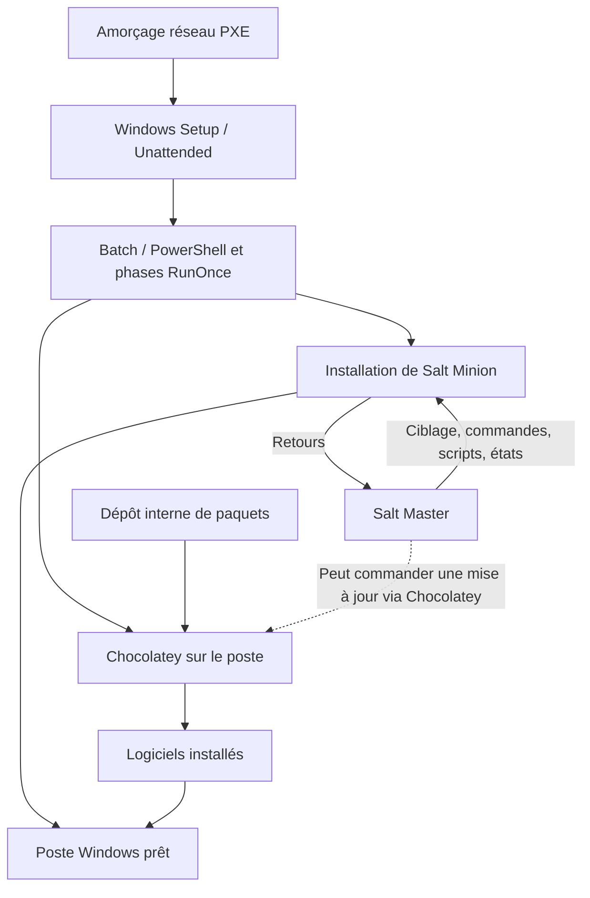

# Windows Endpoint Automation

**Retour d'expérience technique — PXE · Unattended · Batch/PowerShell · Chocolatey · Salt**

Ce portfolio présente deux fonctions **complémentaires mais différentes** :

1. **Déploiement automatisé Windows :** démarrage PXE, Windows Setup piloté par Unattended, enchaînement de scripts Batch/PowerShell, configuration du dépôt Chocolatey interne et **installation des logiciels prévus sur les postes**.
2. **Administration à distance après déploiement :** installation de Salt Minion sur les machines Windows, puis possibilité de les piloter depuis Salt Master (ciblage, commandes CMD/PowerShell, collecte de résultats, contrôle de services, états de configuration). **Salt peut aussi déclencher des mises à jour**, dont des commandes Chocolatey, mais ne se limite pas à celles-ci.

Les deux produits n'ont pas le même rôle : **Chocolatey installe, met à niveau et désinstalle des paquets Windows ; Salt orchestre des actions à distance sur un ou plusieurs postes.**

## Chaîne technique

Le chemin entre Salt Master et Salt Minion représente les possibilités du logiciel et non la topologie exacte du réseau historique. La configuration originale du serveur PXE et du Salt Master n'a pas été fournie.

## Études de cas

| Sujet | Documentation et code |
| --- | --- |
| **01 — Déploiement Windows automatisé** | [Analyse PXE / Unattended](docs/01-pxe-windows.md) · [XML UEFI anonymisé](windows-deployment/unattended/uefi-example.xml) · [scripts en plusieurs phases](windows-deployment/batch/) |
| **02 — Administration Windows à distance et maintenance logicielle** | [Salt et Chocolatey : rôles complémentaires](docs/02-salt-chocolatey-administration.md) · [Exécution Salt](salt/remote-execution.md) · [État Salt illustratif](salt/states/browser-update.sls) |
| **03 — Packaging Chocolatey personnalisé** | [Packaging MSI anonymisé](docs/03-chocolatey-custom-package.md) · [paquet fictif](chocolatey/msi-package-example/) |

L'[ancienne page 02](docs/02-chocolatey-salt-cve.md) redirige vers le nouveau contenu, afin de préserver les liens historiques.

## Ce qui est observable dans les scripts fournis

- Fichiers Unattended avec différentes passes Windows Setup et des modèles de partitionnement UEFI.
- Scripts Windows 11 : `chocolatey.cmd`, `repository.cmd`, `installpackages.cmd` et `installpackages_2.cmd` pour préparer le gestionnaire de paquets et installer des logiciels.
- Deux vagues d'installation, plusieurs redémarrages, `RunOnce`, adaptation de logiciels selon le profil et installation de pilotes.
- **Installation de Salt Minion via Chocolatey**, dans la deuxième phase de préparation du poste, avant son utilisation pour l'administration distante.

## Limites, anonymisation et validation

Les fichiers du dépôt sont **reconstruits et anonymisés** : pas de chemins réseau, d'adresses IP, de binaires propriétaires, de noms de postes, de mots de passe ou de données de production.

Les archives ne comprennent pas les commandes historiques du **Salt Master** : les commandes distantes publiées sont **des exemples techniques de laboratoire**, pas la transcription d'interventions spécifiques. Les versions exactes, le nombre de postes, le ciblage et les résultats historiques ne sont pas attestés.

Le XML d'exemple contient une opération d'effacement du disque cible : **ne pas l'appliquer sur une machine comportant des données**. Le code illustratif n'est pas un système PXE prêt pour la production.

Voir [validation](docs/validation.md), [traçabilité des reconstructions](docs/original-vs-public.md) et [sécurité](SECURITY.md).

Retours d'expérience publiés sur [thadji.fr](https://thadji.fr).
