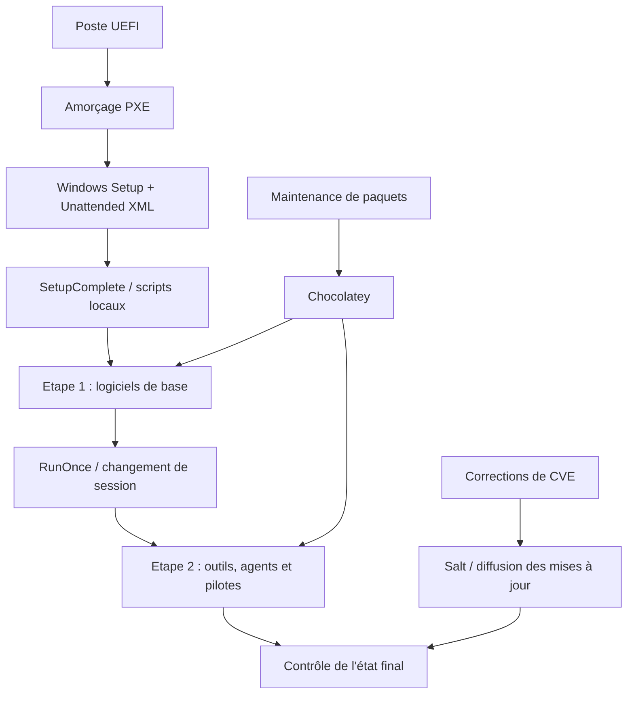

# Windows Endpoint Automation

**Portfolio technique — PXE · Windows Setup · Unattended · Batch/PowerShell · Chocolatey · Salt**

Ce projet documente mes contributions à la **maintenance et à l'évolution d'une chaîne de déploiement Windows** et au maintien des logiciels installés. L'angle est celui du retour d'expérience : comprendre une chaîne existante, l'adapter et en mesurer les limites, plutôt que proposer un tutoriel de déploiement à partir de zéro.

Le code est **reconstruit à partir des mécanismes réellement observés** dans les archives de scripts, les fichiers Unattended et les mécanismes de distribution logicielle. Il ne représente ni les fichiers de production ni une infrastructure autonome exécutable.

## Ce que la chaîne impliquait

L'infrastructure PXE et les états Salt exacts ne figurent pas dans les archives mises à disposition : leur représentation ici est fonctionnelle. Les éléments Windows sont mieux documentés.

## Retours d'expérience

| Sujet | Contenu technique et preuves publiques |
|---|---|
| **01. PXE et préparation Windows** | [Étude de cas détaillée](docs/01-pxe-windows.md), [XML UEFI](windows-deployment/unattended/uefi-example.xml), [scripts multi-étapes](windows-deployment/batch/) |
| **02. Chocolatey / Salt / CVE** | [Gestion des correctifs](docs/02-chocolatey-salt-cve.md), [état Salt illustratif](salt/states/browser-update.sls) |
| **03. Packaging MSI anonymisé** | [Étude de cas](docs/03-chocolatey-custom-package.md), [exemple fictif de paquet](chocolatey/msi-package-example/) |

## Détails techniques représentés

- Modèle UEFI/GPT observé avec **WinRE 650 Mio, EFI 100 Mio, MSR 16 Mio et volume Windows étendu**. Le XML publié est incomplet pour un déploiement réel et contient une instruction destructive de partitionnement : **ne pas l'utiliser sur une machine contenant des données**.
- Enchaînement **SetupComplete → scripts Batch → installation Chocolatey → RunOnce → deuxième vague**, avec des états et des journaux pour la version de démonstration.
- Installation de logiciels standards, profils applicatifs conditionnels et point d'intégration de pilotes via un utilitaire Windows. Le ciblage réseau des postes est remplacé par un profil explicite.
- Illustration de packaging MSI générique : manifeste NuGet, vérification du binaire, installation silencieuse et codes retour.
- Remédiation des mises à jour avec Chocolatey/Salt documentée séparément ; exemple Salt fictif, non issu des états réels.

## Pourquoi ces fichiers diffèrent de l'original

**Anonymiser sans appauvrir** implique de préserver les mécanismes utiles tout en excluant les secrets, topologies, codes sous licence, binaires et manipulations historiques présentant des risques. La [matrice source → reconstruction](docs/original-vs-public.md) décrit les écarts : suppression des connexions automatiques, des contournements de protections et des chemins réseau, sans masquer l'existence de ces contraintes.

La [matrice de validation](docs/validation.md) distingue ce qui est observé dans les sources, ce qui est reconstitué et ce qui reste à tester. Le dépôt **n'est pas un kit de déploiement PXE prêt à lancer**.

## Publication et sécurité

Aucun MSI original, nom de machine, domaine, IP, identifiant ou mot de passe n'est destiné à être publié. Les noms de logiciels connus restent cités pour leur intérêt technique, pas pour dévoiler une infrastructure. Voir [SECURITY.md](SECURITY.md).

Les articles de synthèse et les captures de laboratoire seront publiés sur [thadji.fr](https://thadji.fr), avec liens vers les exemples concernés.
