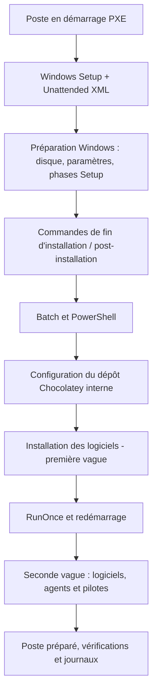

# PXE Boot et Windows : maintenance d'une chaîne de déploiement automatisé

**Retour d'expérience technique** — Ce dossier présente mes interventions sur les mécanismes de préparation des postes Windows. Il accompagne l'article de thadji.fr et **ne constitue pas un tutoriel**. Les exemples de code publiés sont des reconstructions anonymisées.

## 1. Le véritable périmètre : du démarrage réseau à la préparation logicielle

L'installation commençait avec un **amorçage PXE**, puis Windows Setup utilisait un **fichier de réponses Unattended personnalisé** pour automatiser la configuration du système. Une fois Windows installé, des scripts Batch et PowerShell prenaient le relais pour atteindre les ressources réseau, configurer le gestionnaire de paquets Chocolatey, installer les logiciels puis reprendre certaines étapes après redémarrage.

Mon travail s'inscrivait dans la **maintenance et l'évolution d'une chaîne existante** : compréhension des scripts, adaptations Windows, mise à jour des listes de logiciels et fiabilisation de la préparation. Je ne revendique pas la création de l'infrastructure PXE elle-même.

**Séparation essentielle :** ce n'est pas Unattended qui « télécharge tous les paquets ». Unattended configure Windows Setup et peut ordonner l'exécution de commandes. Les scripts prennent ensuite en charge les accès aux ressources, le dépôt Chocolatey et l'installation logicielle.

La configuration exacte du serveur PXE n'est pas présente dans les archives. Les exemples de scripts Windows 11 existent bien ; les fichiers de réponses historiques fournis comprennent différentes variantes et ne permettent pas d'attribuer automatiquement toutes ces configurations à la même image Windows 11.

## 2. Unattended : automatiser le setup Windows

L'archive comporte des modèles de fichiers de réponses utilisant notamment les passes :

- `windowsPE` : paramètres régionaux, préparation des disques, choix de l'image et commandes éventuelles exécutées en préinstallation ;
- `offlineServicing` : paramètres applicables à l'image Windows hors ligne selon les modèles ;
- `specialize` : personnalisation de l'installation et lancement de commandes prévues pour cette phase ;
- `oobeSystem` : configuration initiale et éventuelles commandes de première connexion.

Sur un modèle UEFI, le disque est organisé en quatre partitions : **récupération (650 Mio), EFI (100 Mio), MSR (16 Mio), puis volume Windows occupant le reste**. Cette structure est reproduite dans [l'exemple XML](../windows-deployment/unattended/uefi-example.xml).

L'archive d'origine comporte également des configurations de comptes, de connexion et de rattachement à un domaine. Ces éléments sont exclus de la reconstruction. Le XML public reste **un extrait technique non validé par Windows SIM** ; il contient `WillWipeDisk=true` et ne doit jamais être appliqué sur un disque contenant des données.

## 3. Comment la post-installation prend le relais

La continuité entre Windows Setup et l'installation des logiciels se joue dans les commandes de fin d'installation et les scripts. L'archive contient des séquences associées à `SetupComplete.cmd`, des appels Batch et PowerShell, et des scripts qui préparent leur propre reprise.

Le fonctionnement observé ne consiste pas à exécuter une seule commande après le premier démarrage. On retrouve plusieurs vagues d'actions, séparées notamment par un redémarrage et une entrée de registre `RunOnce`.

Les fichiers reconstruits montrent ce principe :
- [SetupComplete](../windows-deployment/batch/setupcomplete-example.cmd), point d'entrée local de la démonstration ;
- [stage-01](../windows-deployment/batch/stage-01.cmd), première séquence, installation de paquets et préparation de la suite ;
- [stage-02](../windows-deployment/batch/stage-02.cmd), applications complémentaires, profil de poste et mécanisme de pilotes ;
- [installpackages](../windows-deployment/batch/installpackages-example.cmd), commandes Chocolatey et journalisation.

**Limite technique importante :** sous HKLM, `RunOnce` requiert une ouverture de session administrateur appropriée. Il ne s'exécute pas automatiquement au simple redémarrage. La chaîne historique comportait des mécanismes de connexion spécifiques qui ne sont pas publiés ; la version démonstrative ne prétend donc pas reproduire toute la reprise sans interaction.

## 4. Dépôt local Chocolatey : un rôle distinct du XML

Les scripts Windows 11 fournis comprennent une étape `chocolatey.cmd` ainsi que des fichiers `installpackages.cmd` et `installpackages_2.cmd`. Cette distinction est intéressante : la **préparation de l'accès aux ressources et du dépôt** précède la **distribution des logiciels**.

La connexion peut impliquer des ressources réseau et une source Chocolatey configurée localement sur le poste. Il faut distinguer un partage utilisé pour récupérer un script ou un installateur, et une **source de paquets Chocolatey** consommée par `choco install`.

Le [script de source reconstitué](../windows-deployment/batch/repository-example.cmd) n'utilise qu'une URL fictive en `.invalid`, sans conserver le serveur ni les identifiants d'origine.

Le déploiement de logiciels s'effectuait en plusieurs passes : applications courantes, puis logiciels complémentaires, agents et pilotes. Les journaux répartis par étape permettent de comprendre une installation incomplète.

**La chaîne met en place les logiciels et certaines versions attendues au moment du déploiement initial.** La correction des CVE et les mises à jour centralisées **ultérieures** avec Salt correspondent à un autre cycle de maintenance, décrit dans [l'étude de cas dédiée](02-chocolatey-salt-cve.md). Il ne faut pas attribuer automatiquement à Unattended une fonction de veille CVE ou de déploiement continu.

## 5. Redémarrages, profils et dépendances

Les scripts d'origine utilisaient `RunOnce` pour retrouver la suite de l'exécution après certaines étapes. Ils contenaient aussi des branches conditionnelles permettant d'adapter des applications au poste en fonction de son contexte.

Pour ne pas publier les implantations ou réseaux d'origine, la [version publique du profil](../windows-deployment/batch/profile-apps-example.cmd) utilise une variable explicite. Le mécanisme reste le même : **un socle commun, puis des logiciels supplémentaires selon le profil**.

D'autres séquences intègrent des pilotes au travers d'un exécutable de déploiement et de fichiers préparés séparément. Les archives d'installation des pilotes ne sont pas redistribuées.

La principale difficulté technique est l'enchaînement : une installation Windows peut réussir alors qu'un script, une étape `RunOnce` ou un paquet s'est arrêté. Il faut donc vérifier **l'état final des logiciels**, les journaux et les codes de retour, sans assimiler le premier démarrage réussi à un poste prêt.

## 6. Limites et ce que j'en retiens

Ce retour d'expérience concerne la maintenance d'une automatisation préexistante, pas la construction complète d'une infrastructure PXE.

Les sources comportent des pratiques historiques à traiter avec recul : paramètres d'authentification dans des scripts, réduction de certains contrôles Windows ou contournement de vérification d'intégrité. **Ces mécanismes ne sont pas recopiés**, car ils ne doivent pas devenir des recommandations pour un nouveau déploiement.

La version GitHub conserve l'architecture logique, les passes Windows Setup, le partitionnement UEFI, les étapes Batch/PowerShell, Chocolatey, `RunOnce`, les profils et les pilotes. Elle ne fournit ni accès au serveur d'origine, ni image de déploiement complète, ni preuve de tests de bout en bout.

Voir la [correspondance entre l'archive et les fichiers publics](original-vs-public.md) ainsi que la [matrice de validation](validation.md).
