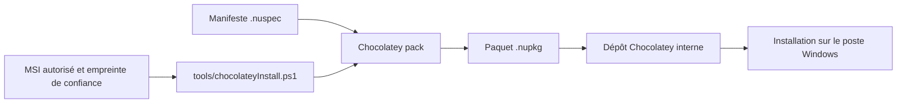

# 03 — Créer un paquet Chocolatey personnalisé à partir d'un MSI

**Article 08 validé pour le blog thadji.fr (publication WordPress à effectuer).** Documentation technique du projet Windows Endpoint Automation.

## Contexte : maintenir un logiciel interne avec Chocolatey

Dans la chaîne de préparation Windows que j'ai contribué à maintenir, certains logiciels nécessitaient leur propre paquet Chocolatey. L'objectif était de **standardiser l'installation silencieuse**, les paramètres d'exécution et les mises à jour, tout en utilisant le dépôt interne déjà prévu pour les postes.

Ce retour d'expérience s'appuie sur ce travail, mais le code de ce dépôt **n'est pas l'ancien paquet interne**. Il s'agit d'une reconstruction générique avec le nom fictif `portfolio-msi-example`, sans identité du produit, fichier propriétaire, serveur, clé ou autre élément confidentiel.

## Du MSI au paquet nupkg



Le paquet public contient :
- [`portfolio-msi-example.nuspec`](../chocolatey/msi-package-example/portfolio-msi-example.nuspec) : identifiant, titre, version fictive, métadonnées ;
- [`tools/chocolateyInstall.ps1`](../chocolatey/msi-package-example/tools/chocolateyInstall.ps1) : contrôle du MSI et lancement silencieux ;
- [README du modèle](../chocolatey/msi-package-example/README.md) : limites et prérequis.

Le dossier **ne contient aucun fichier MSI**. Un laboratoire autorisé doit fournir **un unique MSI** et sa valeur SHA-256 obtenue par un canal fiable. Le script refuse une empreinte absente, mal formée ou différente de celle du fichier.

Le fichier d'installation retrouve le MSI, utilise `Get-FileHash -Algorithm SHA256`, puis appelle `Install-ChocolateyInstallPackage` avec des paramètres de type :

```powershell
$packageArgs = @{
    packageName    = 'portfolio-msi-example'
    fileType       = 'msi'
    file           = $msis[0].FullName
    silentArgs     = '/qn /norestart'
    validExitCodes = @(0, 1641, 3010)
}
Install-ChocolateyInstallPackage @packageArgs
```

Cet extrait est représentatif du script déjà publié : il ne réalise pas une installation réelle sans installeur fourni.

## Codes de retour et redémarrages

- `0` : succès selon Windows Installer ;
- `3010` : succès avec **redémarrage requis** ;
- `1641` : succès avec **redémarrage initié**.

Accepter un code via `validExitCodes` ne garantit pas que l'application soit opérationnelle. La vérification ultérieure doit établir la version installée, les éventuels services associés et le comportement après redémarrage.

## Construire, publier et tester : un processus distinct

Sur un poste de laboratoire disposant de Chocolatey et d'un **MSI autorisé**, les étapes à démontrer sont :

1. inspecter le manifeste et le script, ainsi que la provenance/licence/signature du MSI ;
2. contrôler indépendamment son SHA-256 et fournir l'empreinte attendue à l'environnement de test ;
3. générer le paquet via `choco pack` dans le répertoire du manifeste ;
4. installer depuis une source de **laboratoire**, contrôler le code retour et l'état applicatif ;
5. tester mise à niveau, redémarrage éventuel et désinstallation si cette dernière est supportée ;
6. seulement après validation, examiner la distribution via une source Chocolatey autorisée et les scénarios d'orchestration Salt.

**Ne pas présenter `choco pack` comme une preuve de bonne installation** : la compilation du `.nupkg` et les essais sur Windows sont deux contrôles indépendants. Une dépendance à une variable d'environnement pour l'empreinte doit être documentée et gérée dans chaque contexte d'installation. Ce modèle ne fonctionne pas tel quel pour un déploiement automatisé à grande échelle sans adapter ce mécanisme.

Les exemples Salt du dépôt illustrent uniquement la possibilité de déclencher une commande Chocolatey à distance ; ils ne constituent pas un historique d'exécution de ce paquet.

## Ce qui est établi, ce qui reste à prouver

| Élément | Statut |
|---|---|
| Travail historique de packaging d'une application via Chocolatey | Expérience décrite, détails internes anonymisés |
| Structure .nuspec + installation PowerShell | Exemple public présent dans le dépôt |
| Vérification de fichier MSI et SHA-256 | Logique présente dans le script public |
| Installation réussie d'un MSI précis sur une VM Windows | **Non testée / non attestée dans le dépôt** |
| Cycle de publication sur un dépôt interne et mise à jour de postes réels | Exemples publics non équivalents aux données de production |

Les captures d'écran sont réservées à la **passe finale sur le blog**, après tests de laboratoire et anonymisation.

## Suite de la série Windows

1. [Maintenance de la chaîne PXE / Unattended](01-pxe-windows.md)
2. [Salt pour l'administration distante, Chocolatey pour les logiciels](02-salt-chocolatey-administration.md)
3. **Ce dossier : packaging MSI anonymisé**

Le prochain chantier, distinct de cette série, est un audit et durcissement **Windows Server 2025 en VM de laboratoire**, avec un état initial et un état après modification ; aucun résultat ne sera revendiqué avant exécution.

Documentation : [Chocolatey Docs](https://docs.chocolatey.org/), [Windows Installer](https://learn.microsoft.com/en-us/windows/win32/msi/windows-installer-error-messages).
